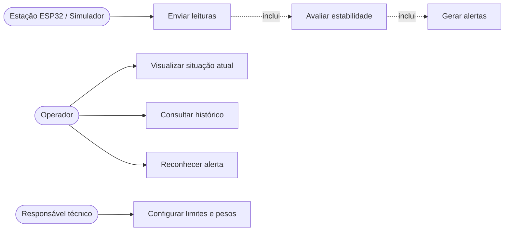

# 1. Levantamento de requisitos

## 1.1 Atores

| Ator | Descrição |
|---|---|
| Estação de aquisição | ESP32 (ou simulador) que lê os sensores e envia os dados. |
| Operador de monitoramento | Acompanha o dashboard, reconhece alertas. |
| Responsável técnico | Define limites de controle e pesos; interpreta resultados. |
| Órgão fiscalizador / gestor | Consulta histórico e relatórios (uso futuro). |

## 1.2 Requisitos funcionais

| ID | Requisito | Onde está implementado |
|---|---|---|
| RF01 | Receber pacotes de leituras de uma ou mais estações via HTTP/JSON. | `monitor/servidor.py` (`POST /api/leituras`) |
| RF02 | Validar os dados recebidos (variável conhecida, valor numérico, instante válido). | `monitor/servico.py` (`validar_pacote`) |
| RF03 | Armazenar todas as leituras com data/hora (UTC) e estação de origem. | `monitor/banco.py` (tabela `leituras`) |
| RF04 | Classificar cada variável em Normal / Atenção / Alerta / Crítico conforme limites de controle. | `monitor/analise.py` (`classificar_valor`) |
| RF05 | Calcular o índice experimental de risco ponderado (0 a 1). | `monitor/analise.py` (`avaliar`) |
| RF06 | Calcular grandezas derivadas: pressão hidrostática, carga piezométrica, tensão efetiva, rᵤ e fator de segurança. | `monitor/analise.py` |
| RF07 | Definir o nível global combinando índice, variáveis críticas e fator de segurança. | `monitor/analise.py` (`avaliar`) |
| RF08 | Gerar alerta quando uma variável ou o nível global sobe de nível, sem repetir alertas pendentes. | `monitor/servico.py` (`_gerar_alertas`) |
| RF09 | Permitir reconhecer (dar ciência de) um alerta. | `POST /api/alertas/{id}/reconhecer` |
| RF10 | Exibir valores atuais, níveis, limites, gráficos históricos e lista de alertas. | `monitor/web/` |
| RF11 | Simular cenários (normal, cheia, infiltração, sismo) para validar o software sem hardware. | `simulador/simulador.py` |

## 1.3 Requisitos não funcionais

| ID | Requisito |
|---|---|
| RNF01 | Executar apenas com Python 3.10+ e biblioteca padrão (sem instalação de pacotes). |
| RNF02 | Atualizar o dashboard em até 5 s após o recebimento de uma leitura. |
| RNF03 | Processar uma leitura (validar, gravar, avaliar, alertar) em menos de 100 ms em um computador comum. |
| RNF04 | Proteger o envio de leituras com chave de API opcional (`BARRAGEM_CHAVE_API`). |
| RNF05 | Limites, pesos e parâmetros geotécnicos configuráveis em um único arquivo (`monitor/config.py`). |
| RNF06 | Firmware tolerante a quedas de rede (fila de reenvio de pacotes). |
| RNF07 | Interface em português, legível em celular e computador, com modo escuro. |
| RNF08 | Deixar explícito, na interface e na documentação, que o resultado não é uma avaliação profissional. |

## 1.4 Regras de negócio

- **RN01** – Os limites de controle de cada variável são crescentes: base < atenção < alerta < crítico.
- **RN02** – Os pesos das variáveis do índice somam 100%. Variáveis com peso 0 são monitoradas e geram alertas individuais, mas não entram no índice.
- **RN03** – Se um sensor do índice estiver sem leitura, os pesos dos demais são reescalados e a cobertura é informada.
- **RN04** – Uma variável crítica eleva o nível global para no mínimo **Alerta**; duas ou mais elevam para **Crítico**.
- **RN05** – Fator de segurança abaixo de 1,5 / 1,3 / 1,1 eleva o nível global para no mínimo Atenção / Alerta / Crítico.
- **RN06** – Um novo alerta da mesma origem só é gerado se o nível for superior ao de um alerta ainda não reconhecido.

## 1.5 Casos de uso

