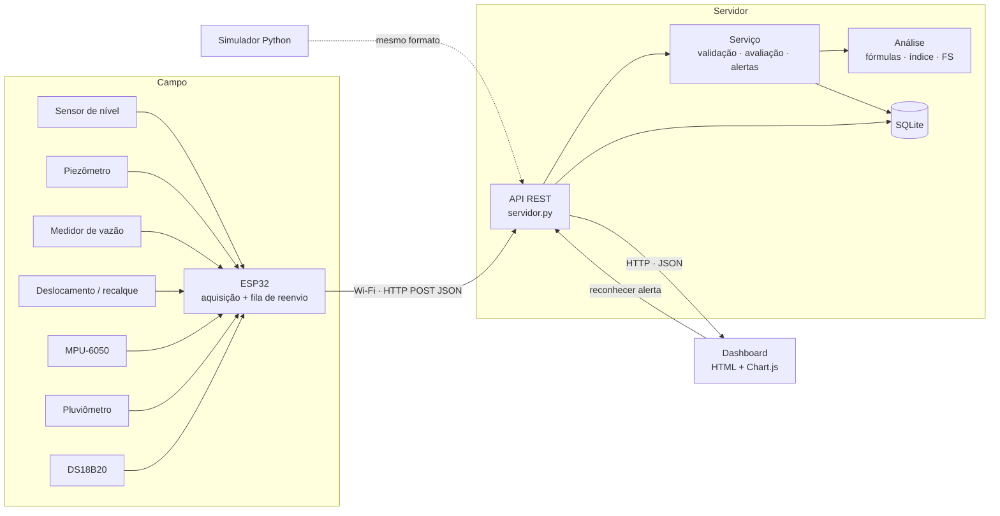
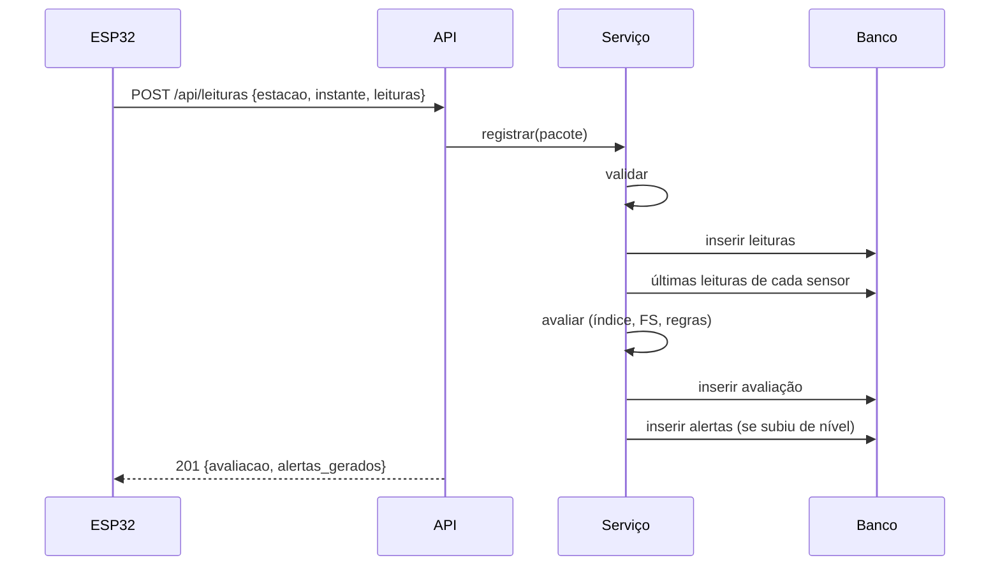

# 4. Arquitetura do sistema

## 4.1 Visão geral



Fluxo: **Sensores → Microcontrolador/IoT → Banco de dados → Software → Dashboard → Alertas**.

## 4.2 Componentes

| Componente | Arquivo | Responsabilidade |
|---|---|---|
| Firmware | `firmware/esp32_barragem/esp32_barragem.ino` | Ler sensores, aplicar calibração, montar JSON, enviar e reenviar em caso de falha. |
| Simulador | `simulador/simulador.py` | Gerar dados de cenários e enviá-los pela mesma API. |
| API REST | `monitor/servidor.py` | Rotas HTTP, autenticação por chave, arquivos do dashboard. |
| Serviço | `monitor/servico.py` | Validação, gravação, avaliação e geração de alertas. |
| Análise | `monitor/analise.py` | Fórmulas, normalização, índice e classificação (funções puras). |
| Configuração | `monitor/config.py` | Limites, pesos e parâmetros geotécnicos. |
| Banco | `monitor/banco.py` | Esquema e consultas SQLite. |
| Dashboard | `monitor/web/` | Interface de visualização. |

A separação entre **análise** (sem dependências) e **serviço/banco** permite
testar a metodologia isoladamente e trocar o banco (por exemplo, para
PostgreSQL/TimescaleDB ou InfluxDB) sem mexer nas regras.

## 4.3 Sequência de uma leitura



## 4.4 API

| Método | Rota | Descrição |
|---|---|---|
| `POST` | `/api/leituras` | Recebe um pacote de leituras. Cabeçalho `X-Chave-API` se `BARRAGEM_CHAVE_API` estiver definida. |
| `GET` | `/api/estado` | Última avaliação, últimas leituras, sensores e limites. |
| `GET` | `/api/historico?variavel=pressao_poros&horas=24` | Série histórica de uma variável. |
| `GET` | `/api/indice?horas=24` | Série histórica do índice, FS e nível global. |
| `GET` | `/api/alertas?pendentes=1` | Alertas (todos ou só os não reconhecidos). |
| `POST` | `/api/alertas/{id}/reconhecer` | Marca um alerta como reconhecido. |
| `GET` | `/` | Dashboard. |

Exemplo de pacote:

```json
{
  "estacao": "EST-01",
  "instante": "2026-10-14T12:00:00Z",
  "leituras": {
    "nivel_reservatorio": 10.4,
    "pressao_poros": 16.2,
    "vazao_infiltracao": 19.8,
    "deslocamento_horizontal": 3.1,
    "recalque": 8.0,
    "chuva_24h": 2.5,
    "inclinacao": 0.06,
    "vibracao": 0.003,
    "temperatura": 26.4
  }
}
```

`instante` é opcional (se ausente, usa-se a hora de chegada). Nem todas as
variáveis precisam vir no mesmo pacote: a avaliação usa a última leitura
conhecida de cada sensor.

## 4.5 Escolhas tecnológicas

| Escolha | Motivo | Alternativa em produção |
|---|---|---|
| Python + biblioteca padrão | Roda em qualquer computador sem instalação; código fácil de ler. | FastAPI / Flask |
| SQLite | Arquivo único, sem servidor, suficiente para o protótipo. | PostgreSQL + TimescaleDB, InfluxDB |
| HTTP + JSON | Simples de depurar e suportado pelo ESP32. | MQTT (menor consumo, melhor para muitas estações) |
| Chart.js | Gráficos simples no navegador. | Grafana |
| ESP32 | Wi-Fi integrado, ADC, baixo custo. | Datalogger industrial, LoRaWAN para locais remotos |
