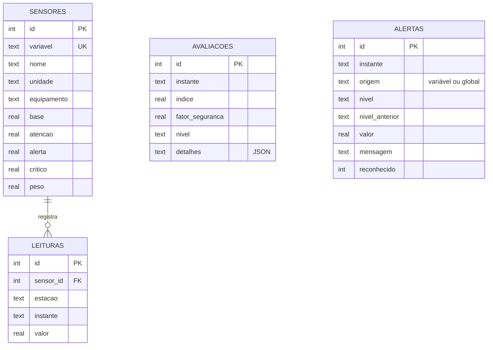

# 5. Banco de dados

SQLite, esquema criado automaticamente por `monitor/banco.py` ao iniciar o
servidor. Os instantes são gravados em texto ISO 8601 (UTC), o que permite
ordenar e filtrar por comparação de strings.

## 5.1 Modelo entidade-relacionamento



## 5.2 Tabelas

| Tabela | Conteúdo | Observações |
|---|---|---|
| `sensores` | Cadastro das variáveis, limites e pesos. | Sincronizada com `config.py` a cada inicialização, guardando os limites em vigor. |
| `leituras` | Uma linha por variável por pacote recebido. | Índice `(sensor_id, instante)` para consultas de histórico. |
| `avaliacoes` | Resultado de cada avaliação (índice, FS, nível e JSON completo). | Permite auditar por que um nível foi atribuído. |
| `alertas` | Alertas gerados e se foram reconhecidos. | `origem = 'global'` para o nível geral. |

## 5.3 Consultas úteis

```sql
-- Últimas 10 leituras do piezômetro
SELECT l.instante, l.valor FROM leituras l JOIN sensores s ON s.id = l.sensor_id
WHERE s.variavel = 'pressao_poros' ORDER BY l.instante DESC LIMIT 10;

-- Máximo diário da vazão de infiltração
SELECT substr(l.instante, 1, 10) AS dia, MAX(l.valor) AS vazao_max
FROM leituras l JOIN sensores s ON s.id = l.sensor_id
WHERE s.variavel = 'vazao_infiltracao' GROUP BY dia ORDER BY dia;

-- Tempo em cada nível global
SELECT nivel, COUNT(*) AS avaliacoes FROM avaliacoes GROUP BY nivel;

-- Alertas pendentes
SELECT instante, nivel, mensagem FROM alertas WHERE reconhecido = 0 ORDER BY id DESC;
```

Para abrir o banco: `sqlite3 barragem.db` ou o programa *DB Browser for SQLite*.

## 5.4 Evolução

- Tabela `estacoes` (localização, coordenadas, responsável) e `instrumentos`
  (vários piezômetros por variável, com posição na seção da barragem).
- Histórico de alterações de limites (quem alterou, quando e por quê).
- Política de retenção / agregação (médias horárias após N dias).
