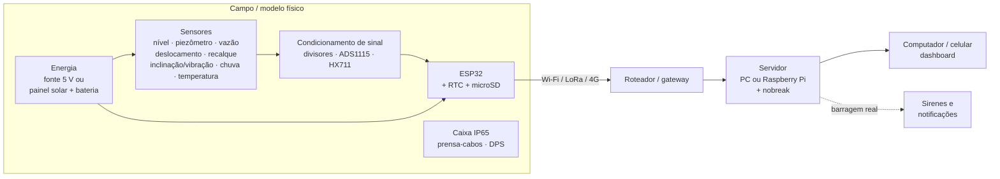

# 8. Hardware necessário para a aplicação ser válida

Este documento lista **todo o hardware** necessário para que o sistema funcione
de forma válida, ou seja, para que cada variável usada pelo software
(`monitor/config.py`) tenha um sensor real por trás, com leitura confiável,
horário correto, alimentação contínua e comunicação com o servidor.

O documento está dividido em duas partes:

- **Parte A – Protótipo acadêmico:** hardware de baixo custo para montar e
  validar o sistema em bancada ou em um modelo físico de barragem em escala.
- **Parte B – Aplicação em uma barragem real:** o que precisa ser trocado ou
  acrescentado para o sistema ser usado em uma estrutura de verdade.

As ligações elétricas, conversões e o passo a passo de calibração estão em
[06 – Hardware](06-hardware.md).

**Legenda de prioridade**

| Marca | Significado |
|---|---|
| **Obrigatório** | Sem ele o sistema não cumpre o objetivo (variável sem sensor, sem energia ou sem comunicação). |
| **Recomendado** | O sistema funciona sem ele, mas a precisão ou a confiabilidade ficam prejudicadas. |
| **Opcional** | Melhoria ou alternativa. |

---

## 8.1 Visão geral da cadeia de hardware

## 8.2 Critério de validade

A aplicação é considerada **válida** quando todos os itens abaixo são atendidos:

| # | Critério | Hardware envolvido | Como verificar no software |
|---|---|---|---|
| 1 | Todas as variáveis com peso no índice têm sensor instalado | Sensores das seções 8.3.2 a 8.3.8 | Dashboard mostra **cobertura de 100%** |
| 2 | Sensores calibrados contra uma referência conhecida | Ferramentas da seção 8.3.15 | Leitura do sensor ≈ valor de referência (registrar em planilha) |
| 3 | Sinais dentro da faixa elétrica do ESP32 (≤ 3,3 V) | Divisores de tensão, ADS1115 | Nenhum valor saturado (sempre no máximo) |
| 4 | Faixa dos sensores compatível com a grandeza medida | Escolha do modelo (ver 8.3.3) | Valores variam de forma coerente com o ensaio |
| 5 | Horário correto em cada leitura | NTP (Wi-Fi) ou RTC DS3231 | Instante das leituras no histórico bate com o relógio |
| 6 | Energia contínua durante o monitoramento | Fonte, bateria, painel solar | Não há lacunas no gráfico histórico |
| 7 | Comunicação com o servidor e reenvio em falhas | Wi-Fi/roteador (ou LoRa/4G), microSD | Pacotes chegam com `201`; nenhuma lacuna após queda de rede |
| 8 | Proteção física dos componentes | Caixa IP65, prensa-cabos | Sem umidade/oxidação após os ensaios |
| 9 | Servidor ligado 24 h durante o período de monitoramento | PC/Raspberry Pi + nobreak | Dashboard acessível; alertas registrados |

> Se algum sensor do índice estiver ausente, o software continua funcionando
> (os pesos são reescalados), mas a análise fica **parcial** e a cobertura
> mostrada no dashboard fica abaixo de 100%. Para apresentar resultados como
> válidos, a cobertura deve ser 100%.

---

# Parte A – Protótipo acadêmico

## 8.3.1 Unidade de aquisição de dados

| Item | Prioridade | Especificação mínima | Função |
|---|---|---|---|
| **ESP32 DevKit V1** (ESP-WROOM-32) | Obrigatório | 240 MHz, Wi-Fi 2,4 GHz, ADC 12 bits, 3,3 V | Lê os sensores, aplica calibração, envia JSON ao servidor. É a placa para a qual o firmware foi escrito. |
| **ADS1115** (ADC 16 bits, I2C) | Recomendado | 4 canais, 16 bits, ganho programável | O ADC interno do ESP32 é pouco linear e ruidoso; o ADS1115 melhora muito a leitura de pressão e deslocamentos. *Exige adaptar o firmware.* |
| **RTC DS3231** (relógio de tempo real) | Recomendado | ±2 ppm, bateria CR2032 | Mantém o horário correto quando não há internet para o NTP. *Exige adaptar o firmware.* |
| **Módulo microSD** + cartão 4–32 GB | Recomendado | SPI, FAT32 | Guarda as leituras localmente. A fila em memória do firmware só comporta 20 pacotes (20 min). *Exige adaptar o firmware.* |
| Conversor de nível lógico 4 canais | Opcional | 3,3 V ↔ 5 V bidirecional | Alternativa mais limpa aos divisores resistivos para sinais digitais de 5 V. |
| Placa perfurada / PCB, bornes KRE, conectores | Obrigatório | — | Montagem definitiva (protoboard serve só para testes de bancada). |

**Por que o ESP32 e não Arduino Uno ou Raspberry Pi?** O ESP32 tem Wi-Fi
integrado, várias interrupções para os contadores de pulso (vazão e chuva),
I2C e ADC, baixo consumo e baixo custo. Um Arduino Uno precisaria de módulo de
rede extra; um Raspberry Pi consome mais energia e não tem ADC.

## 8.3.2 Nível do reservatório → `nivel_reservatorio` (peso 15%)

| Item | Prioridade | Especificação | Observações |
|---|---|---|---|
| **JSN-SR04T** (ultrassônico à prova d'água) | Obrigatório (campo) | Faixa ≈ 0,25–4,5 m; resolução ≈ 1 cm; 5 V | Para ambientes externos e úmidos. Distância mínima de ~25 cm: instalar o sensor acima do nível máximo. |
| **HC-SR04** | Alternativa (bancada) | Faixa ≈ 0,02–4 m; 5 V | Mais barato e mede distâncias curtas; não é à prova d'água. Bom para o modelo em escala em ambiente interno. |
| Suporte rígido + tubo de proteção (PVC 100 mm) | Obrigatório | — | Evita leituras falsas causadas por ondas, espuma e objetos. |
| Régua linimétrica | Recomendado | Graduação em cm | Referência visual para calibrar e conferir o sensor. |

Por que é necessário: o nível do reservatório é a **carga hidráulica** sobre a
barragem e entra no cálculo da pressão hidrostática (P = ρ·g·h).

## 8.3.3 Pressão de poros → `pressao_poros` (peso 25%)

| Item | Prioridade | Especificação | Observações |
|---|---|---|---|
| **Transdutor de pressão 0,5–4,5 V** (aço inox, rosca 1/4") | Obrigatório | Alimentação 5 V; exatidão típica ±1% a ±2% do fundo de escala | Escolher a faixa de acordo com a coluna d'água esperada (ver abaixo). |
| **MPX5010DP** (0–10 kPa) | Alternativa (modelo em escala) | Saída 0,2–4,7 V; 5 V | Para colunas d'água pequenas (até ~1 m). Exige ajustar `PIEZO_V_MIN`/`PIEZO_V_MAX` no firmware. |
| Tubo piezométrico (PVC/acrílico) com ponta porosa ou filtro geotêxtil | Obrigatório | Ø 20–25 mm | Funciona como um piezômetro de tubo aberto (tipo Casagrande). |
| Divisor de tensão 10 kΩ / 20 kΩ | Obrigatório | Resistores 1% | Reduz a saída de até 4,5 V para ≤ 3,3 V (firmware usa fator 1,5). |

**Escolha da faixa:** a exatidão é um percentual do fundo de escala. Um sensor
de 0–1,2 MPa com ±1% erra até ±12 kPa, o que é maior que toda a faixa de
alerta do projeto (15 a 45 kPa). Para a barragem de referência (15 m), um
sensor de **0–100 kPa** é adequado; para um modelo em escala com menos de 1 m
de água, use um sensor de **0–10 kPa**.

Por que é necessário: é a variável de **maior peso** no índice e a única usada
no cálculo do **fator de segurança** e da tensão efetiva (σ' = σ − u). Sem ela,
o FS não é calculado.

## 8.3.4 Vazão de infiltração → `vazao_infiltracao` (peso 20%)

| Item | Prioridade | Especificação | Observações |
|---|---|---|---|
| **YF-S201** (sensor de fluxo Hall, 1/2") | Obrigatório (vazões de 1 a 30 L/min) | 5 V; f(Hz) = 7,5 × Q(L/min) | Compatível com o firmware atual. |
| **YF-S401** | Alternativa | 0,3–6 L/min | Para vazões menores. Ajustar `PULSOS_POR_LPM` conforme a folha de dados. |
| **Célula de carga 5 kg + HX711** sob um recipiente coletor | Alternativa (modelo em escala) | 24 bits | Em modelos pequenos a infiltração é de mL/min, abaixo do mínimo do YF-S201. A vazão sai de Δmassa/Δt. *Exige adaptar o firmware.* |
| Canaleta ou dreno coletor + mangueira | Obrigatório | — | Conduz toda a água infiltrada até o sensor. |
| Recipiente transparente para observação | Recomendado | — | Permite ver a **turbidez** (água barrenta pode indicar erosão interna), que o sensor não mede. |

## 8.3.5 Deslocamento horizontal → `deslocamento_horizontal` (peso 20%)

| Item | Prioridade | Especificação | Observações |
|---|---|---|---|
| **Potenciômetro linear (régua resistiva) 50 mm** | Obrigatório | 5 kΩ; linearidade ≤ 0,1%; alimentado em 3,3 V | Funciona como extensômetro: uma haste presa ao talude empurra o cursor. |
| Potenciômetro deslizante comum (60 mm) | Alternativa barata | — | Funciona para demonstração, mas com folga mecânica e menor linearidade. |
| Haste de referência cravada em ponto fixo + suporte | Obrigatório | — | O sensor mede o movimento relativo entre o talude e um ponto que não se move. |
| Paquímetro (calibração) | Obrigatório | 0,02 mm | Ver seção 8.3.15. |

## 8.3.6 Recalque → `recalque` (peso 10%)

| Item | Prioridade | Especificação | Observações |
|---|---|---|---|
| **Potenciômetro linear 100 mm** | Obrigatório | Mesmo tipo do item anterior, instalado na vertical | Mede o movimento vertical da crista em relação a uma referência fixa. |
| Placa de recalque (chapa apoiada na crista) + haste | Obrigatório | — | Transfere o movimento do solo para o cursor. |

## 8.3.7 Inclinação e vibração → `inclinacao` (5%) e `vibracao` (alerta individual)

| Item | Prioridade | Especificação | Observações |
|---|---|---|---|
| **MPU-6050** (módulo GY-521) | Obrigatório | Acelerômetro 3 eixos, 16 bits, ±4 g (configurado no firmware), I2C | Um único módulo fornece as duas variáveis: inclinação (ângulo) e vibração (pico de aceleração). |
| Base rígida aparafusada à estrutura | Obrigatório | — | Se o módulo estiver solto, a leitura de inclinação não tem significado. |
| **ADXL355** | Alternativa (melhor precisão) | Ruído muito menor, melhor estabilidade térmica | Indicado se o MPU-6050 apresentar deriva excessiva. *Exige adaptar o firmware.* |

## 8.3.8 Chuva → `chuva_24h` (peso 5%)

| Item | Prioridade | Especificação | Observações |
|---|---|---|---|
| **Pluviômetro de báscula** com reed switch | Obrigatório | 0,2794 mm por basculada (ajustar ao modelo) | Peça de reposição de estações meteorológicas. Instalar nivelado, longe de árvores e telhados. |
| Cabo 2 vias + resistor de pull-up (interno do ESP32) | Obrigatório | — | O firmware conta as basculadas por interrupção, com debounce de 200 ms. |

## 8.3.9 Temperatura → `temperatura` (contexto)

| Item | Prioridade | Especificação | Observações |
|---|---|---|---|
| **DS18B20** (versão à prova d'água, cabo 1 m) | Recomendado | −55 a 125 °C; ±0,5 °C | Usado para contexto e para corrigir a deriva térmica de outros sensores. |
| Resistor 4,7 kΩ (pull-up) | Obrigatório se usar o DS18B20 | — | Entre o pino de dados e 3,3 V. |

## 8.3.10 Alimentação

**Opção 1 – Bancada / laboratório** (obrigatório escolher uma das opções)

| Item | Especificação |
|---|---|
| Fonte chaveada 5 V / 2 A (ou carregador USB de boa qualidade) | Alimenta o ESP32 e os sensores de 5 V |
| Nobreak para o roteador e o servidor | Recomendado, evita lacunas nos dados |

**Opção 2 – Campo (sem tomada)**

| Item | Especificação |
|---|---|
| Bateria 12 V selada (VRLA/AGM) 9 Ah | Autonomia de ~3 dias sem sol (cálculo abaixo) |
| Painel solar 20 W | Recarrega a bateria |
| Controlador de carga PWM 10 A | Protege a bateria contra sobrecarga e descarga profunda |
| Conversor step-down 12 V → 5 V, 3 A (LM2596 ou MP1584) | Alimenta o ESP32 e os sensores |
| Fusível 2 A na saída da bateria | Proteção contra curto-circuito |

**Dimensionamento (estimativa):**

| Grandeza | Cálculo | Resultado |
|---|---|---|
| Consumo médio | ESP32 com Wi-Fi + sensores ≈ 150 mA × 5 V | ≈ 0,75 W |
| Energia por dia | 0,75 W × 24 h | ≈ 18 Wh/dia |
| Bateria para 3 dias sem sol (uso de 50% da capacidade) | 18 × 3 ÷ 0,5 | ≈ 108 Wh → **12 V × 9 Ah** |
| Painel | 18 Wh ÷ (4,5 h de sol pleno × 0,7 de eficiência) | ≈ 6 W → **20 W** com margem para recarregar a bateria |

O firmware atual mantém o ESP32 sempre ligado (para amostrar a vibração). Usar o
modo *deep sleep* entre leituras reduziria bastante o consumo, mas deixaria de
detectar vibrações entre as leituras.

## 8.3.11 Comunicação

| Item | Prioridade | Observações |
|---|---|---|
| **Roteador / ponto de acesso Wi-Fi 2,4 GHz** | Obrigatório | O ESP32 não conecta em redes de 5 GHz. Alcance típico de dezenas de metros. |
| Antena externa / repetidor Wi-Fi | Opcional | Para estações mais distantes do roteador. |
| Módulo **LoRa** (SX1276/SX1262) + gateway | Opcional (campo) | Alcance de quilômetros com baixo consumo; usado onde não há Wi-Fi. *Exige adaptar o firmware.* |
| Modem **4G/LTE** (ex.: SIM7600) + chip de dados | Opcional (campo) | Envio direto à internet a partir de locais remotos. *Exige adaptar o firmware.* |

## 8.3.12 Proteção física e elétrica

| Item | Prioridade | Observações |
|---|---|---|
| **Caixa hermética IP65** (≈ 20 × 15 × 10 cm) | Obrigatório (campo) | Abriga ESP32, conversores e bornes. |
| Prensa-cabos PG7/PG9 | Obrigatório (campo) | Um para cada cabo que entra na caixa. |
| Sachê de sílica gel | Recomendado | Reduz a condensação dentro da caixa. |
| Cabos blindados (sinais analógicos) | Recomendado | Reduz ruído em cabos longos. |
| **DPS** (dispositivo de proteção contra surtos) + aterramento | Recomendado (campo) | Protege contra surtos de descargas atmosféricas em cabos longos. |
| Fusíveis | Obrigatório (campo) | Na saída da bateria e do painel. |

## 8.3.13 Servidor e visualização

| Item | Prioridade | Especificação |
|---|---|---|
| **Computador para o servidor** (notebook/PC) ou **Raspberry Pi 4/5** | Obrigatório | Qualquer máquina com Python 3.10+. O Raspberry Pi é melhor para ficar ligado 24 h com baixo consumo. |
| Cartão microSD 32 GB classe A1 / SSD (se usar Raspberry Pi) | Obrigatório com Raspberry Pi | Armazena o sistema e o banco SQLite. |
| Nobreak | Recomendado | Mantém servidor e roteador ligados em quedas de energia. |
| Celular ou computador com navegador | Obrigatório | Para acessar o dashboard. |

## 8.3.14 Modelo físico em escala (para os ensaios)

Necessário apenas se o grupo for testar o sistema em uma barragem em miniatura.

| Item | Função |
|---|---|
| Caixa de acrílico/vidro (≈ 80 × 30 × 40 cm) | Contém o reservatório e o maciço |
| Solo argiloso/arenoso peneirado e compactado em camadas | Maciço da barragem |
| Bomba d'água submersa pequena + registro | Enche o reservatório de forma controlada (simula a cheia) |
| Dreno de pé (brita fina + geotêxtil) e saída com mangueira | Coleta a água infiltrada até o sensor de vazão |
| Tubo piezométrico inserido no maciço | Abriga o transdutor de pressão |
| Hastes de referência fixadas na estrutura da caixa | Base para os potenciômetros de deslocamento e recalque |
| Regador ou chuveiro | Simula chuva sobre o modelo e o pluviômetro |

> **Importante:** os limites de alerta em `monitor/config.py` foram definidos
> para uma barragem fictícia de 15 m. Em um modelo de 30–40 cm, as pressões,
> vazões e deslocamentos são muito menores; **os limites devem ser
> reescalados** para o modelo, senão o sistema nunca sairá do nível Normal.

## 8.3.15 Ferramentas e materiais de montagem e calibração

| Item | Uso |
|---|---|
| Multímetro digital | Conferir tensões dos divisores e da alimentação (obrigatório) |
| Ferro de solda, estanho, sugador | Montagem definitiva |
| Protoboard, jumpers, kit de resistores | Testes de bancada |
| Trena e régua | Calibração do sensor de nível |
| Coluna d'água graduada (tubo transparente com régua) | Calibração do transdutor (1 m de água = 9,81 kPa) |
| Proveta ou balde graduado + cronômetro | Calibração do sensor de vazão |
| Paquímetro | Calibração dos potenciômetros |
| Seringa / béquer graduado | Calibração do pluviômetro (mm = volume ÷ área de captação) |
| Nível de bolha | Instalação do pluviômetro e referência do MPU-6050 |

## 8.3.16 Lista de compras consolidada (protótipo)

Valores **aproximados de referência**, apenas para planejamento. Os preços
variam bastante entre fornecedores e ao longo do tempo: **confirmar antes de
comprar**.

| Qtde | Item | Prioridade | Faixa estimada (R$) |
|---:|---|---|---:|
| 1 | ESP32 DevKit V1 | Obrigatório | 40 – 70 |
| 1 | JSN-SR04T (ou HC-SR04 para bancada) | Obrigatório | 50 – 90 (10 – 20) |
| 1 | Transdutor de pressão 0,5–4,5 V (ou MPX5010DP) | Obrigatório | 60 – 150 |
| 1 | YF-S201 (ou célula de carga + HX711) | Obrigatório | 25 – 45 (20 – 40) |
| 1 | Potenciômetro linear 50 mm | Obrigatório | 80 – 200 |
| 1 | Potenciômetro linear 100 mm | Obrigatório | 100 – 250 |
| 1 | MPU-6050 (GY-521) | Obrigatório | 15 – 30 |
| 1 | Pluviômetro de báscula | Obrigatório | 120 – 350 |
| 1 | DS18B20 à prova d'água | Recomendado | 15 – 30 |
| 1 | ADS1115 | Recomendado | 25 – 50 |
| 1 | RTC DS3231 | Recomendado | 15 – 30 |
| 1 | Módulo microSD + cartão | Recomendado | 30 – 50 |
| 1 | Kit de resistores, placa perfurada, bornes, jumpers, cabos | Obrigatório | 50 – 100 |
| 1 | Fonte 5 V / 2 A | Obrigatório (bancada) | 25 – 40 |
| 1 | Caixa IP65 + prensa-cabos | Obrigatório (campo) | 60 – 130 |
| 1 | Kit solar: painel 20 W, bateria 12 V 9 Ah, controlador, step-down | Obrigatório (campo) | 350 – 600 |
| 1 | Roteador Wi-Fi 2,4 GHz | Obrigatório (se não houver) | 100 – 200 |
| 1 | Raspberry Pi 4 (opcional: pode usar um notebook) | Opcional | 400 – 700 |
| 1 | Materiais do modelo físico (caixa, bomba, mangueiras, solo) | Se houver modelo | 200 – 450 |

**Resumo aproximado:**

| Configuração | Inclui | Faixa estimada (R$) |
|---|---|---:|
| Bancada mínima | Itens obrigatórios de sensores + ESP32 + fonte + montagem | ≈ 565 – 1.325 |
| Bancada recomendada | Mínima + ADS1115, RTC, microSD, DS18B20 | ≈ 650 – 1.485 |
| Campo | Recomendada + caixa IP65 + kit solar | ≈ 1.060 – 2.215 |

---

# Parte B – Aplicação em uma barragem real

Os sensores de baixo custo validam o **software** e a **arquitetura**, mas não
têm precisão, durabilidade nem rastreabilidade de calibração para monitorar uma
barragem de verdade. Para uma aplicação real, cada item é substituído por
instrumentação geotécnica profissional, instalada por empresa especializada e
definida no projeto de instrumentação da barragem.

## 8.4.1 Instrumentos por variável

| Variável no software | Instrumento profissional | Características típicas | Integração com o sistema |
|---|---|---|---|
| `nivel_reservatorio` | Sensor de nível **radar** ou **transdutor submersível**, + régua linimétrica | Exatidão milimétrica, imune a espuma e chuva (radar) | Saída 4–20 mA ou SDI-12 → datalogger |
| `pressao_poros` | **Piezômetros de corda vibrante** (ex.: Geokon 4500) ou piezômetros de tubo aberto (Casagrande) com medidor elétrico | Estáveis por décadas, resistentes a cabos longos; vários instrumentos por seção | Interface de corda vibrante → datalogger |
| `vazao_infiltracao` | **Medidor de vazão por vertedor** (triangular ou retangular) com sensor de nível na caixa, ou calha Parshall | Mede desde vazões pequenas; permite inspeção visual da turbidez | Nível no vertedor → vazão por equação do vertedor |
| `deslocamento_horizontal` | **Inclinômetros** (sonda manual ou *in-place*), **marcos superficiais** com estação total robótica ou **GNSS RTK** | Resolução submilimétrica ao longo da profundidade | Digital (RS-485/SDI-12) ou leituras importadas |
| `recalque` | **Medidores de recalque magnéticos**, placas de recalque, marcos superficiais | Recalque por camada do maciço | Leitura manual/automática importada |
| *(futuro)* tensão total | **Células de pressão total** de corda vibrante | Instaladas durante a construção | Interface de corda vibrante |
| `chuva_24h` | Pluviômetro de báscula profissional (com aquecimento, se necessário) | Certificado de calibração | Pulsos → datalogger |
| `inclinacao` | **Tiltímetros** biaxiais (MEMS ou eletrolíticos) | Resolução de milésimos de grau | RS-485/SDI-12 |
| `vibracao` | **Acelerógrafo** de movimento forte | Registra eventos sísmicos com gatilho | Saída digital / rede |
| `temperatura` | Termistores (normalmente embutidos nos instrumentos de corda vibrante) | Usados na correção das leituras | Datalogger |

## 8.4.2 Aquisição, energia e comunicação

| Item | Função |
|---|---|
| **Datalogger industrial** (ex.: Campbell Scientific CR1000X) com multiplexadores | Substitui o ESP32: lê dezenas de instrumentos, opera de −40 a 70 °C, armazena meses de dados localmente. |
| Interfaces de corda vibrante / 4–20 mA / SDI-12 / RS-485 | Padrões de sinal dos instrumentos profissionais. |
| Sistema solar dimensionado + baterias com autonomia de vários dias | Alimentação em locais sem rede elétrica. |
| Comunicação redundante: rádio, LoRaWAN, 4G, fibra ou **satélite** | Garante o envio mesmo com falha de um meio. |
| Abrigo/painel metálico IP66, aterramento, **para-raios e DPS** em todas as linhas | Proteção contra intempéries e descargas atmosféricas. |

## 8.4.3 Centro de monitoramento e alerta

| Item | Função |
|---|---|
| Servidores redundantes (ou nuvem) com banco de séries temporais | Alta disponibilidade e retenção de longo prazo. |
| Nobreak + gerador | Funcionamento durante falta de energia. |
| Telas de monitoramento 24 h | Acompanhamento contínuo pela equipe. |
| Notificação por SMS, e-mail, aplicativo e telefone | Avisar os responsáveis técnicos. |
| **Sirenes e sistemas de alerta à população** | Previstos no Plano de Ação de Emergência (PAE) conforme a regulamentação do órgão fiscalizador, especialmente para a Zona de Autossalvamento. |

## 8.4.4 Requisitos para a validade em uma barragem real

- Instrumentos com **certificado de calibração** rastreável (laboratórios da RBC/Inmetro ou do fabricante).
- Projeto de instrumentação feito por **engenheiro responsável**, definindo
  posição, quantidade e limites de controle de cada instrumento.
- **Leituras manuais periódicas** para conferir as leituras automáticas.
- Manutenção preventiva e verificação dos instrumentos e da comunicação.
- Integração com as inspeções de segurança e o Plano de Segurança da Barragem
  exigidos pela Lei nº 12.334/2010.

Ordem de grandeza de custo: cada instrumento profissional custa da ordem de
**milhares de reais**, e um sistema completo de monitoramento automatizado pode
chegar a **centenas de milhares de reais**, conforme o porte da barragem.

---

## 8.5 Matriz de rastreabilidade: software × hardware

| Chave no software | Peso | Protótipo | Interface / pino ESP32 | Barragem real |
|---|---:|---|---|---|
| `nivel_reservatorio` | 15% | JSN-SR04T / HC-SR04 | Digital: GPIO 5 (TRIG), GPIO 18 (ECHO) | Radar / transdutor submersível |
| `pressao_poros` | 25% | Transdutor 0,5–4,5 V / MPX5010DP | Analógico: GPIO 34 | Piezômetro de corda vibrante |
| `vazao_infiltracao` | 20% | YF-S201 / célula de carga + HX711 | Pulsos: GPIO 27 | Vertedor + sensor de nível |
| `deslocamento_horizontal` | 20% | Potenciômetro linear 50 mm | Analógico: GPIO 35 | Inclinômetro / marcos / GNSS |
| `recalque` | 10% | Potenciômetro linear 100 mm | Analógico: GPIO 32 | Medidor de recalque magnético |
| `chuva_24h` | 5% | Pluviômetro de báscula | Pulsos: GPIO 26 | Pluviômetro profissional |
| `inclinacao` | 5% | MPU-6050 | I2C: GPIO 21/22 | Tiltímetro |
| `vibracao` | — | MPU-6050 | I2C: GPIO 21/22 | Acelerógrafo |
| `temperatura` | — | DS18B20 | 1-Wire: GPIO 4 | Termistores dos instrumentos |

## 8.6 Itens que exigem alteração no firmware

O firmware atual (`firmware/esp32_barragem/esp32_barragem.ino`) já suporta o
conjunto **principal** de sensores. As alternativas abaixo precisam de código
adicional antes de serem usadas:

| Hardware | Alteração necessária |
|---|---|
| ADS1115 | Ler pressão e deslocamentos pelo I2C em vez de `analogReadMilliVolts` (biblioteca Adafruit ADS1X15). |
| RTC DS3231 | Usar o RTC como fonte de horário quando o NTP falhar (biblioteca RTClib). |
| Módulo microSD | Gravar os pacotes não enviados em arquivo e reenviá-los depois (biblioteca SD). |
| Célula de carga + HX711 | Calcular a vazão a partir da variação de massa (biblioteca HX711). |
| MPX5010DP | Apenas ajustar as constantes `PIEZO_V_MIN`, `PIEZO_V_MAX` e `PIEZO_KPA_MAX`. |
| YF-S401 | Apenas ajustar `PULSOS_POR_LPM`. |
| ADXL355, LoRa, 4G | Novos drivers de comunicação/leitura. |

## 8.7 Referências

1. Agência Nacional de Águas e Saneamento Básico (ANA) — manuais sobre segurança e instrumentação de barragens.
2. U.S. Bureau of Reclamation — *Embankment Dam Instrumentation Manual*.
3. U.S. Bureau of Reclamation — *Design Standards No. 13: Embankment Dams*.
4. Brasil. Lei nº 12.334/2010 — Política Nacional de Segurança de Barragens.
5. Folhas de dados (*datasheets*) dos componentes: ESP32, JSN-SR04T, HC-SR04, MPX5010, YF-S201, MPU-6050, DS18B20, ADS1115, DS3231.
